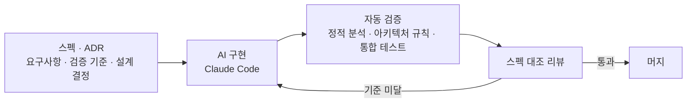

## About

Kotlin · Spring 백엔드 개발자 
결제·구독 서비스, 커뮤니티 서비스 백엔드 개발 · 개인 서비스 「거닐강」 운영 중

## How I Work

- **스펙이 AI의 정답지** — 검증 기준이 없으면 AI는 요구사항을 추측해서 그럴듯하게 구현합니다. 그래서 구현보다 스펙을 먼저 씁니다
- **결정은 기록으로** — 대안과 기각 이유까지 ADR에 남겨, 요구사항이 바뀌어도 영향 범위를 추적합니다
- **AI의 오판은 규칙으로** — 틀린 판단은 작업 규칙으로 쌓아 같은 실수가 반복되지 않게 합니다
- **동시성은 실제로 경쟁시켜서** — 목(mock)이 아니라 실제 PostgreSQL·Redis에서 여러 스레드를 경쟁시켜 확인합니다

## Featured

### 거닐강 — 강원도 AI 여행 코스 추천

2026 한국관광공사 관광데이터 활용 공모전 출품 · App Store 출시 · 백엔드 1인 개발 (서비스 운영 중이라 레포는 비공개)

| 풀어낸 문제 | 방법 |
|---|---|
| 추천이 맞는지 감으로 판단하던 문제 | 골든셋 질의 37개로 검색 품질을 수치화 — hit@10 97% → 질의 확장 후 100% |
| LLM이 없는 장소를 지어내는 환각 | Structured Output + 후보 장소 ID enum으로 후보 밖 응답 자체를 차단 |
| 관광 데이터 갱신 비용 | 변경분만 동기화하고, 내용이 바뀐 장소만 임베딩 재계산 |
| 「배포 성공」인데 5일간 500이던 사고 | 배포 후 공개 URL 스모크 체크 — 상태코드로 실패 원인까지 구분 |

### payment-concurrency-lab — 이중 결제 방지 실험

같은 결제 승인 알림 100개를 동시에 보내 다섯 가지 처리 방식을 실제 PostgreSQL·Redis에서 비교 · Spec Kit으로 스펙부터 작성

| 풀어낸 문제 | 방법 |
|---|---|
| 같은 승인 알림이 동시에 와서 생기는 이중 승인 | 조건부 상태 전이 + 유일 제약 — 100개 동시 × 10회 모두 승인 1건·오류 0 (조회 후 저장은 최대 32건 중복) |
| 「왜 분산 락을 안 썼나」 | Redis 잠금은 처리 시간이 TTL을 넘으면 중복 승인 — 테스트로 재현하고 기각 사유를 ADR로 기록 |
| PG 응답 유실로 결과를 모르는 결제 | 3초 타임아웃 후 거래조회 최대 3회로 확정, 끝까지 모르면 「확인 필요」로 분리 |
| 동시 승인 요청이 PG를 여러 번 호출 | 자체 검토에서 발견 → 스펙에 요구사항 추가 후 수정, PG 호출 10번 → 1번 |

## Experience

- **오코랩스** · 백엔드 2026.07 – 2026.11 — 보안업체 S사 구독 서비스몰. 이중 결제 방지, 멱등성 공통 계층, PG 연동, 정기결제 배치, 환불 도메인 단독 설계
- **피피프렌즈** · 백엔드 2024.08 – 2025.11 — 반려동물 소셜 커뮤니티 API 개발·운영. 이벤트 기반 알림(응답 약 30% 개선), APM 모니터링 직접 구축, 데드락·커넥션 풀 고갈 해결

## Tech Stack

<table>
<tr><td><b>Language</b></td><td>  </td></tr>
<tr><td><b>Backend</b></td><td>    </td></tr>
<tr><td><b>Data</b></td><td>     </td></tr>
<tr><td><b>AI</b></td><td>   </td></tr>
<tr><td><b>Infra</b></td><td>    </td></tr>
<tr><td><b>Test · Ops</b></td><td>    </td></tr>
</table>

## Contributions

<picture>
  <source media="(prefers-color-scheme: dark)" srcset="https://raw.githubusercontent.com/yjy8501/yjy8501/output/github-snake-dark.svg"/>
  
</picture>

